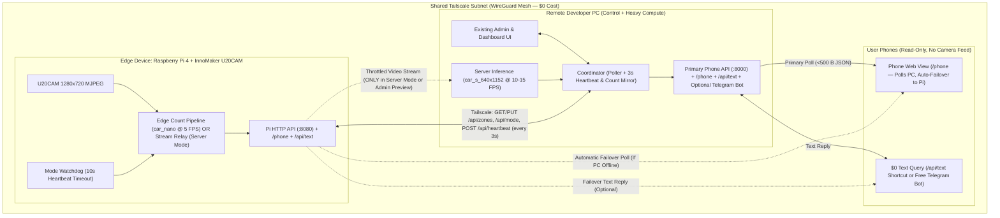

# Raspberry Pi 4 `carcounter` Evaluation, 3-Tier Tailscale Architecture & Implementation Plan

> **Document Purpose:** This document consolidates everything discovered in the existing Jetson and Raspberry Pi `carcounter` codebases, evaluates hardware/OS/camera feasibility on your stripped 2 GB Raspberry Pi 4, and lays out the exact architecture and implementation plan for your revision before any code is modified.

---

## Part 1: What We Learned (Audit of Existing Codebases & Pi 4 Hardware)

### 1.1 Two Versions of `carcounter` Found on This Jetson

1. **Live Jetson Deployment ([/opt/carcounter/](file:///opt/carcounter/count.py) & [carcounter.service](file:///etc/systemd/system/carcounter.service)):**
   - Runs TensorRT FP16 (`car_s_640x1152_fp16.engine`) on the Jetson Orin NX GPU capped at 510 MHz.
   - Per [/data/carcounter/state.json](file:///data/carcounter/state.json), it sustains **40.8 FPS** (`4.1 ms` preprocess, `19.6 ms` inference, `0.5 ms` postprocess, `0.4 ms` track+count).
   - Uses the exact **InnoMaker U20CAM-1080P** USB 2.0 camera via GStreamer (`1280×720@30` MJPEG, `power_line_frequency=2` for 60 Hz US anti-flicker, `videoflip method=rotate-180`).
   - Serves the ParkLabs HTTP API on `127.0.0.1:8080` and Tailscale (`parklabs_api.py`):
     - `GET /api/info`, `GET /api/zones`, `GET /api/counts` (unauthenticated reads; Tailscale is the boundary)
     - `PUT /api/zones`, `POST /api/counts/reset` (`Authorization: Bearer <PARKLABS_COUNTER_TOKEN>`)
     - **Live Video (`LiveFeed`):** `GET /snapshot.jpg` and `GET /stream.mjpg[?raw=1]`, which only JPEG-encode frames on demand (up to `STREAM_MAX_FPS = 15`, `JPEG_QUALITY = 85`) when a client requests them, and only draw overlays (`draw_overlay`) when `annotated_clients > 0`.
   - **Historical Zone Evidence:** [/data/carcounter/counts_state.json](file:///data/carcounter/counts_state.json#L43-L46) still contains an older event with `"zone": "outside"`, and [parklabs_line.py](file:///opt/carcounter/parklabs_line.py#L12-L13) notes that it restricted the generic ParkLabs 3–32 point polygon rules down to a single 2-point `"line"`.

2. **Headless Raspberry Pi 4 Bundle ([carcounter_pi/](file:///home/hoquelab/carcounter_pi) & [carcounter_pi.tar.gz](file:///home/hoquelab/carcounter_pi.tar.gz)):**
   - Ports inference to `onnxruntime` CPU via `ORTBackend` in [rt_backend.py](file:///home/hoquelab/carcounter_pi/rt_backend.py#L61-L71) (`intra_op_num_threads = min(8, os.cpu_count() or 1)` -> 4 threads on Pi 4).
   - Ships two ONNX models (both verified via [SHA256SUMS](file:///home/hoquelab/carcounter_pi/models/SHA256SUMS)):
     - `car_nano_416x736.onnx` (~3.7 MB, `3,711,621` bytes) — designed for Pi 4 CPU (~4–5 FPS per [carcounter.conf](file:///home/hoquelab/carcounter_pi/carcounter.conf#L4-L5)).
     - `car_tiny_416x736.onnx` (~20.2 MB, `20,227,331` bytes) — ~3× slower on Pi 4 CPU (~1.5 FPS).
   - Includes a GStreamer pre-decode thinning filter (`videorate max-rate=$CAMERA_FPS` before `jpegdec`) in [carcounter.conf](file:///home/hoquelab/carcounter_pi/carcounter.conf#L15) so the Pi does not waste CPU decoding frames it won't infer on.
   - All 6 existing unit tests in [tests/test_parklabs.py](file:///home/hoquelab/carcounter_pi/tests/test_parklabs.py) pass under `/usr/bin/python3`.

### 1.2 Four Gaps in `carcounter_pi` vs. Your Requirements

1. **No Video Endpoints on the Pi:** [carcounter_pi/parklabs_api.py](file:///home/hoquelab/carcounter_pi/parklabs_api.py#L198-L199) explicitly returns HTTP `404` for `/snapshot.jpg` and `/stream.mjpg`. Without those, the Admin UI cannot view the Pi camera to draw IN/OUT boxes, and the Remote Developer PC cannot pull video frames for Server Inference.
2. **2-Point Line Only (No IN/OUT Boxes):** [carcounter_pi/parklabs_line.py](file:///home/hoquelab/carcounter_pi/parklabs_line.py#L105-L115) rejects any zone payload unless it has exactly 1 zone tagged `"line"` with 2 points. [linecount.py](file:///home/hoquelab/carcounter_pi/linecount.py) only computes directional line crossings, not box entry/exit counting.
3. **No Dual-Mode Inference (`edge` ↔ `server`) or Automatic Fallback:** There is no API to pause local ONNX inference and stream video to the Remote Developer PC, no heartbeat/count-mirroring endpoint (`POST /api/heartbeat`), and no watchdog to fail back to Edge inference if the Remote PC sleeps or disconnects.
4. **No Client User Phone View or `$0` Text-Response Interface:** Neither the Remote PC coordinator nor the Pi exposes a read-only `/phone` GUI or a `/api/text` (or Telegram bot) response interface.

---

### 1.3 Raspberry Pi 4 & InnoMaker U20CAM-1080P Feasibility Matrix

Evaluated directly against [rasp-4-specs.md](file:///home/hoquelab/rasp-4-specs.md) and the InnoMaker U20CAM-1080P specs:

| Component | Target Pi 4 / Camera Spec | `carcounter` Requirement | Feasibility & Engineering Notes |
| :--- | :--- | :--- | :--- |
| **CPU & Arch** | Broadcom BCM2711, 4× ARM Cortex-A72 (`aarch64`) | 64-bit ARM (`aarch64`) required for `onnxruntime` | **Compatible (~4–5 FPS Edge).** `car_nano_416x736.onnx` runs ~4–5 FPS on 4× Cortex-A72 cores (good for parking lots/garages `<15 mph`). `car_tiny` (~1.5 FPS) and `car_s_640x1152` (~0.5 FPS) are too slow on the Pi CPU, so `car_s_640x1152` is reserved for **Server Inference** on the Remote PC. **Active fan + heatsink required** to prevent thermal throttling at 80°C, plus a solid 5V/3A USB-C PSU. |
| **Memory** | `1.8 GiB` RAM + `1.8 GiB` `zram0` swap | Headless OS (~200 MB) + Python/OpenCV/ORT (~280 MB) + `LiveFeed` (~6 MB) | **Compatible (~500 MB total).** Stripped of desktop/GUI (`multi-user.target`), **>1.2 GiB RAM remains free**—no OOM risk. |
| **OS & Python** | Debian GNU/Linux 13 (`trixie`), Kernel `6.12.62+rpt-rpi-v8` | `python3-opencv` (with GStreamer), `numpy`, `scipy`, `onnxruntime` | **Compatible (with `pip` upgrade).** Debian 13 ships Python 3.13. During `carcounter setup` ([carcounter](file:///home/hoquelab/carcounter_pi/carcounter#L124)), we should upgrade `pip` inside `./venv` first so PyPI resolves a prebuilt `cp313` `manylinux_2_27_aarch64` wheel for `onnxruntime`, while continuing to inherit apt's `python3-opencv` for GStreamer support. |
| **Storage** | 58 GiB SD (`37 GiB` free on `mmcblk0p2`) | App + venv (<250 MB) + CSV/JSON state + optional training frames | **Compatible.** Set `COLLECT_MAX_GB=0` in `carcounter.conf` once site fine-tuning data is collected (or offload frames to the Remote PC) to avoid unnecessary SD card write wear. |
| **Camera & USB** | InnoMaker U20CAM-1080P (USB 2.0 UVC 1.0, MJPEG & YUY2, 130° DFOV / ~103–106° HFOV) | V4L2 + GStreamer `1280×720@30` MJPEG | **Compatible & Already Tuned.** Stripped of other USB peripherals, the Pi 4's VL805 controller / USB 2.0 root hub (`480 Mbps`) easily handles `1280×720@30` MJPEG (~25–35 Mbps, ~1W USB power). Avoid `YUY2` at 1080p (drops to 5 FPS over USB 2.0). |
| **Camera Orientation & Device ID** | `carcounter.conf` hardcodes `SN0001` & `rotate-180` | V4L2 path + optional flip | Verify `ls /dev/v4l/by-id/` on the Pi (fallback to `/dev/video0` if serial differs). Add `FLIP_180=true|false` in `carcounter.conf` so you can mount the PCB either right-side up (zero-overhead raw MJPEG passthrough in Server mode) or upside-down (`videoflip method=rotate-180`) without editing GStreamer pipelines. |

---

## Part 2: Planned 3-Tier Architecture Over Tailscale (With Automatic Fallback)

All three tiers (**Raspberry Pi 4**, **Remote Developer PC**, and **User Phones**) are already on the **same Tailscale subnet**. This is the ideal transport: **$0 recurring cost**, end-to-end WireGuard encryption, automatic NAT traversal to your remote PC, and zero public port forwarding on the Pi or PC.

### 2.1 System Diagram



### 2.2 Operating States & Automatic Fallback

| Operating State | What Runs on Pi 4 | What Runs on Remote PC | What User Phones Poll |
| :--- | :--- | :--- | :--- |
| **State A: Edge Inference (`mode="edge"`, Default)** | Runs `car_nano_416x736.onnx` locally @ `CAMERA_FPS=5`. Serves `/api/*`, `/phone`, `/api/text`, and on-demand `/snapshot.jpg` + `/stream.mjpg` (only encodes video when Admin UI opens preview). **~0 KB/s idle video uplink.** | Polls Pi `GET /api/counts` every 1–2s for Dashboard UI and serves primary `/phone` & `/api/text`. | Polls **Remote PC** first (`<500 B` JSON) -> protects Pi CPU when multiple phones view at once. |
| **State B: Server Inference (`mode="server"`)** | Pauses ONNX + ByteTrack (**frees ~85% of Pi CPU**). Streams throttled video over Tailscale (`1280×720` @ **10 FPS MJPEG quality 70 ≈ 3–4 Mbps**, or hardware H.264 `v4l2h264enc` @ 15 FPS ≈ 1–1.5 Mbps to fit remote internet upload). | Runs `count.py` with **`car_s_640x1152`** against the Pi stream. Every **3 seconds**, sends `POST /api/heartbeat` to the Pi carrying `{mode: "server", initial, entered, left, events}` so the Pi mirrors the live inventory in `counts_state.json`. | Polls **Remote PC** (`<500 B` JSON) — seamless across mode switches because the URL never changes. |
| **State C: Failover (Remote PC Sleeps / Reboots / Offline)** | **10s Watchdog Trigger:** If no `POST /api/heartbeat` arrives for **10 seconds** while in `server` mode, the Pi automatically flips itself back to `mode="edge"`, loads `car_nano_416x736.onnx`, and continues counting from the **exact last mirrored `inventory`**. | Offline / Unreachable. | Phone Web View (`/phone`, cached in browser via Service Worker) tries `http://<remote-pc>:8000/api/counts` (`2.5s` timeout), fails over automatically to **`http://<pi>:8080/api/counts`** (`<500 B` JSON, **zero video**, `<0.2%` Pi CPU). |

### 2.3 Why Remote Uplink Throttling Matters
Because the Developer PC is at a **remote destination** over Tailscale (not local LAN), streaming raw `1280×720@30` MJPEG would push **~20–30 Mbps continuously** over the site's internet upload. Therefore, in `server` mode, we will configure a dedicated `SERVER_STREAM_FPS` (default `10` FPS) and `SERVER_JPEG_QUALITY` (default `70`), bringing continuous remote upload down to **~3–4 Mbps** (still 2× the Pi's Edge frame rate), with optional GStreamer hardware H.264 (`v4l2h264enc`, **~1–1.5 Mbps** at 15 FPS) if site upload bandwidth is tight.

### 2.4 Zero-Fee (`$0`) Phone GUI & Text-Response Options
1. **Read-Only Phone Web View (`GET /phone`) — `$0`:**
   - Tiny (`<5 KB`) responsive single-page web UI hosted identically on both the Remote PC and the Pi (cached via Service Worker so opening it works even if the PC went offline first).
   - Displays **only** the processed vehicle count (`Inventory`, `Entered`, `Left`, `Last Updated`, `Mode/Source` badge)—**never exposes camera streams**.
   - Includes a clean text-query box/button for instant plain-text status.
2. **Plain-Text Endpoint (`GET /api/text`) — `$0`:**
   - Returns clean `text/plain`, e.g., `42 cars inside (In: 58, Out: 16) | Source: Edge Pi | Updated 2s ago`.
   - Can be called directly by a 1-tap **iOS Siri Shortcut** or **Android Home Screen Widget** over Tailscale with PC→Pi failover.
3. **Optional Telegram Bot (`@BotFather`) — `$0` Forever:**
   - Users send `"count"` (or tap a button) in Telegram and receive the plain-text count back.
   - Uses outbound HTTPS polling (zero domain, zero Twilio/SMS carrier fees), runs on the Remote PC normally, and can optionally fail over to the Pi if desired.

---

## Part 3: IN/OUT Box Counting Logic (`Enters Box → Leaves Box → Increment`)

Per your specification (*"enters box IN leave box IN increment"*), we will replace the single 2-point tripwire restriction with polygon/box zone counting (`BoxCounter`) using each ByteTrack `track_id`'s anchor point (`center` or `bottom`) tested against normalized `0..1` `[x, y]` polygons via `cv2.pointPolygonTest`.

### 3.1 Per-Track State Machine

For each configured box (`IN` box and `OUT` box):

```
  [OUTSIDE] ──(inside box for >= min_enter_frames, default 2)──► [ARMED] ──(leaves box for >= min_exit_frames, default 1)──► [COUNTED (+1)]
```

1. **Entry Confirmation (`OUTSIDE → ARMED`):** A tracked vehicle's anchor enters `Box IN` (or `Box OUT`) and stays inside for `>= min_enter_frames` consecutive frames (default `2`) to prevent 1-frame bounding-box jitter from arming a false detection.
2. **Exit Trigger (`ARMED → COUNTED`):** Once `ARMED`, as soon as the track's anchor exits that box for `>= min_exit_frames` consecutive frames (default `1`), the counter **increments `entered` (for `Box IN`) or `left` (for `Box OUT`) by `+1`**, logs the crossing to `events.csv` and `CountsState`, and records `track_id` in `done` so the same vehicle is **never double-counted** in that box.

### 3.2 Two Edge Cases to Confirm During Your Revision

1. **Box Touching the Frame Border:** If `Box IN` is drawn right up against the edge of the camera image, an entering car might drive into `Box IN` (`ARMED`) and then disappear off-camera on the next frame without ever registering a frame *outside* the box.
   - *Design choice:* Keep boxes slightly inset from the camera border (recommended), **or** enable an optional flag (`count_on_lost_near_edge`) if a box must touch the border.
2. **Separate Lanes vs. Single Shared Driveway:**
   - **Separate Entry & Exit Lanes:** `Box IN` sits over the entry lane and `Box OUT` sits over the exit lane; each box operates independently (`enter -> leave -> increment`).
   - **Single Shared Lane:** If cars drive through *both* boxes on a single ramp, independent box firing would increment both `IN` and `OUT` for the same car unless each `track_id` is locked after its first direction or counted by `Box A -> Box B` transition. *(Please confirm which lane geometry your camera watches.)*

---

## Part 4: Planned Code Implementation Steps (After Your Revision)

Once you revise this document and share your sample `zones.json` payload, we will implement the changes cleanly in 4 stages:

### Step 1: IN/OUT Box Geometry & Counting Engine (`carcounter_pi/`)
- **New `carcounter_pi/boxcount.py`:** Implement `BoxCounter` (`OUTSIDE -> ARMED -> COUNTED` on exit) with `forget(alive_ids)` memory cleanup, per-class vote aggregation, and optional backward-compatible fallback to `LineCounter` if a 2-point `"line"` is supplied.
- **Update `carcounter_pi/parklabs_line.py`:**
  - Replace the 2-point `"line"`-only check with polygon box validation (`3..32` points per zone, `0..1` coordinates, matching the exact `tags` / `id` contract from your Admin UI sample JSON).
  - Update `draw_overlay()` (ported from `/opt/carcounter/parklabs_line.py`) to draw colored `IN` / `OUT` polygons, `ARMED` track badges, and current inventory banner on `/stream.mjpg`.

### Step 2: Dual-Mode Inference, Video Streaming, Watchdog & Phone Endpoints (`carcounter_pi/`)
- **Update `carcounter_pi/parklabs_api.py`:**
  - Port `LiveFeed` from `/opt/carcounter/parklabs_api.py` to restore on-demand `GET /snapshot.jpg` and `GET /stream.mjpg[?raw=1]` (with `raw=1` FPS cap + JPEG quality control for Server mode).
  - Add **`GET /api/mode`** and **`PUT /api/mode`** (`{"mode": "edge" | "server"}`, Bearer-token protected).
  - Add **`POST /api/heartbeat`** (Bearer-token protected): updates `last_server_heartbeat_ts` and atomically mirrors the Remote PC's `{initial, entered, left, events}` into `CountsState`.
  - Add **`GET /phone`** (static HTML/JS + Service Worker read-only mobile GUI with PC→Pi failover) and **`GET /api/text`** (plain-text response for Siri Shortcuts / widgets / curl).
- **Update `carcounter_pi/count.py`:**
  - Support dynamic switching between `edge` mode (capture → ONNX inference → ByteTrack → `BoxCounter` → `LiveFeed`) and `server` mode (capture → `LiveFeed` only, skipping ONNX/ByteTrack to keep Pi CPU low).
  - Run the **10-second heartbeat watchdog** in `server` mode: if the Remote PC stops sending heartbeats, automatically switch back to `edge` mode and resume counting from the mirrored `CountsState`.
- **Update `carcounter_pi/carcounter.conf` & `carcounter_pi/carcounter`:**
  - Add `FLIP_180`, `SERVER_STREAM_FPS=10`, `SERVER_JPEG_QUALITY=70`, `FALLBACK_TIMEOUT_SEC=10`, and `PC_API_URL` (for `/phone` primary polling config).
  - Update `carcounter setup` to upgrade `pip` inside `./venv` for Debian 13 (Python 3.13) wheel resolution.

### Step 3: Remote Developer PC Coordinator (`server_coordinator/`)
- Create a clean Python service for your Remote Developer PC that:
  - Runs `count.py` (with `car_s_640x1152.onnx` or `.engine` / CUDA) pulling `http://<pi-tailscale-ip>:8080/stream.mjpg?raw=1` when `mode=server`.
  - Sends `POST /api/heartbeat` every 3 seconds with live counts in `server` mode, or polls `GET /api/counts` every 1–2 seconds in `edge` mode.
  - Exposes `GET /api/counts`, `GET /phone`, `GET /api/text`, mode toggle control, and (if desired) the `$0` Telegram bot worker.

### Step 4: Tests & Re-packaging
- Expand `carcounter_pi/tests/test_parklabs.py` with unit + HTTP integration tests covering:
  - `BoxCounter` state transitions (`enter -> confirm -> leave -> increment`, jitter rejection, no double-counting).
  - `PUT /api/zones` polygon schema validation and hot-reload.
  - `PUT /api/mode` (`edge` ↔ `server`), `POST /api/heartbeat` mirroring, and automatic 10s timeout fallback (`server -> edge`).
  - `/snapshot.jpg`, `/stream.mjpg`, `/phone`, and `/api/text`.
- Run the full test suite and rebuild `/home/hoquelab/carcounter_pi.tar.gz`.

---

## Part 5: Your Revision Checklist & Sample JSON Input

Before I write any code, please review this plan and reply with:

1. **Sample `PUT /api/zones` JSON Payload from Your Admin UI:**
   Please paste an example of what your existing Admin UI sends (or expects back from `GET /api/zones`), especially the exact `id` and `tags` values for the `IN` and `OUT` boxes:
   ```json
   {
     "version": 1,
     "zones": [
       { "id": "???", "poly": [[0.1, 0.2], [0.4, 0.2], [0.4, 0.8], [0.1, 0.8]], "tags": ["???"] },
       { "id": "???", "poly": [[0.6, 0.2], [0.9, 0.2], [0.9, 0.8], [0.6, 0.8]], "tags": ["???"] }
     ]
   }
   ```
2. **Driveway / Box Geometry:**
   - Are `Box IN` and `Box OUT` on **two separate lanes** (entry lane vs. exit lane), or **one shared lane**?
   - Are the boxes drawn **slightly inside** the frame edges (so cars visibly exit the box before leaving the camera view)?
3. **Remote Developer PC Environment:**
   - What OS (Linux / Windows) and GPU (NVIDIA CUDA vs. CPU-only) does your Remote Developer PC run, so we configure `server_coordinator/` cleanly for it?
4. **Text-Response Scope (`$0`):**
   - Should we include **both** `/phone` + `/api/text` (works natively over Tailscale) **and** a free Telegram bot script, or just `/phone` + `/api/text`?
5. **Any Revisions to Timeouts / Defaults:**
   - Currently proposed: `CAMERA_FPS=5` (Edge), `SERVER_STREAM_FPS=10` @ JPEG quality `70` (Remote Server Mode), `3s` heartbeat interval, `10s` Edge auto-fallback timeout. Let me know if you want any of these tuned differently.
